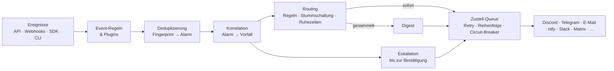

# OpenRelay

**Event-Intelligence statt Benachrichtigungsflut.** OpenRelay ist ein kostenloses, selbst hostbares
Open-Source-System, das Ereignisse aus beliebigen Anwendungen empfängt, zusammengehörige Probleme
erkennt und nur das weiterleitet, was wirklich jemanden braucht: an Discord, Telegram, E-Mail, Slack,
Matrix, ntfy (Handy & Desktop) und viele mehr.

> Dein Server stürzt ab, ein GitHub-Workflow schlägt fehl, eine API wirft 500er.
> Statt 347 Nachrichten bekommst du **eine**: *„🔴 [P1] #42 Postgres nicht erreichbar – 3 Alarme · 347 Ereignisse,
> vermutete Ursache: postgres ist Abhängigkeit von api, worker“*. Mit einem Button zum Bestätigen und einer Eskalation,
> falls niemand reagiert.

## Warum noch ein Benachrichtigungssystem?

[ntfy](https://github.com/binwiederhier/ntfy) und [Apprise](https://github.com/caronc/apprise) sind hervorragend darin,
Nachrichten zuzustellen. Sie stellen aber jede Nachricht zu. OpenRelay setzt **davor** an und entscheidet,
*was* zugestellt werden sollte. ntfy und Apprise lassen sich dabei als Ausgabekanäle nutzen.

| | ntfy / Apprise | OpenRelay |
| --- | --- | --- |
| Nachricht zustellen | ✅ | ✅ (11 Kanäle + Apprise-Brücke + Plugins) |
| 200 gleiche Fehler → 1 Meldung | – | ✅ Fingerprinting mit Normalisierung |
| Zusammengehörige Fehler verknüpfen | – | ✅ Korrelation mit nachvollziehbarer Begründung |
| Ursache erkennen | – | ✅ über Service-Abhängigkeiten |
| Eskalation, wenn niemand reagiert | – | ✅ mehrstufig, mit Bestätigungs-Links |
| Wiederkehrende Probleme erkennen | – | ✅ „zum 4. Mal in 30 Tagen“ |
| Unwichtiges sammeln (Digest), Ruhezeiten | – | ✅ |
| Aus Korrekturen lernen | – | ✅ manuelles Zusammenführen/Trennen wirkt auf künftige Vorfälle |

## Funktionen

- **Universal API** – JSON, Klartext (`curl -d "Backup kaputt"`), SDK, CLI und fertige Webhook-Adapter für
  GitHub, GitLab, Prometheus Alertmanager, Grafana und Uptime Kuma.
- **Deduplizierung** – Ereignisse werden über einen Fingerprint zu *Alarmen* zusammengefasst. Variable Teile
  (IDs, Zahlen, IPs, Zeitstempel, Hashes) werden vorher normalisiert, sodass
  `Timeout after 3021 ms for order 1234` und `Timeout after 12 ms for order 98765` dasselbe Problem sind.
- **Korrelation** – Alarme werden zu *Vorfällen* gruppiert, und zwar anhand mehrerer Signale, die gewichtet und
  kombiniert werden (siehe [Korrelation](#korrelation)). Jede Zuordnung wird begründet.
- **Ursachenanalyse** – Mit einer einfachen Service-Topologie (`api → postgres`) erkennt OpenRelay die vermutliche
  Ursache und führt Folgefehler automatisch zusammen, sobald die gemeinsame Ursache auftaucht.
- **Prioritäten** – P1–P5 aus Schweregrad und Ausmaß. Kritisches geht sofort raus, Unwichtiges wird als
  Zusammenfassung gesammelt. Ruhezeiten pro Regel, Kritisches darf trotzdem wecken.
- **Smart Routing** – Regeln mit einer kleinen Bedingungssprache (`severity >= high`, `labels.env = prod`,
  `service =~ ^api-`) und einem Simulator im Dashboard.
- **Eskalationsrichtlinien** – „Nach 10 min ohne Bestätigung → Telegram, nach weiteren 20 min → Handy“, mit
  Wiederholungen. Bestätigen per Dashboard, API oder signiertem Link direkt aus der Benachrichtigung.
- **Rauschunterdrückung** – Flatter-Erkennung, Alarm-Sturm-Bündelung, Volumenregeln („100 Warnungen in 5 min →
  kritisch“), Event-Regeln (verwerfen, umschreiben) und Stummschaltungen für Wartungsfenster.
- **Verknüpfte Vorfälle** – „möglicherweise verwandt“, „wiederkehrend“ und „zusammengeführt“, inklusive Historie.
- **Offline-Queue** – Zustellungen liegen persistent in SQLite, werden pro Kanal in Reihenfolge mit Backoff
  wiederholt (inkl. `Retry-After`) und durch einen Circuit-Breaker geschützt. Das SDK puffert auch clientseitig.
- **Plugin-System** – Eigene Kanäle, Eingangs-Adapter und Event-Prozessoren als einfache JS-Dateien.
- **Self-Hosting** – ein Container, eine SQLite-Datei, keine Cloud, keine Accounts. Dashboard (React), Live-Updates
  per SSE, Browser-Desktop-Benachrichtigungen, Prometheus-Metriken, YAML-Konfiguration für GitOps.

## So funktioniert es



| Begriff | Bedeutung |
| --- | --- |
| **Ereignis** | Eine einzelne Meldung („HTTP 500 auf /checkout“). |
| **Alarm** | Alle Ereignisse mit gleichem Fingerprint. Zählt mit, kennt `firing`/`resolved`. |
| **Vorfall** | Ein oder mehrere zusammengehörige Alarme, also *ein Problem*. Wird benachrichtigt, eskaliert, bestätigt, gelöst. |

## Schnellstart

### Docker (empfohlen)

```bash
git clone https://github.com/HelloYoshino/OpenRelay.git && cd OpenRelay
docker compose up -d
docker compose logs openrelay | grep -A2 "Admin-Token"   # Token beim ersten Start
```

Dashboard: <http://localhost:8080> → mit dem Admin-Token anmelden → Kanal anlegen → Routing-Regel anlegen → fertig.

### Ohne Docker (Node.js ≥ 22.13)

```bash
npm install
npm run build
OPENRELAY_ADMIN_TOKEN=geheim npm start
```

Für die Entwicklung: `npm run dev` (Server mit Reload) und `npm run dev:web` (Dashboard auf Port 5173 mit Proxy).

## Ereignisse senden

**curl, JSON:**

```bash
curl -X POST http://localhost:8080/api/v1/events \
  -H "Authorization: Bearer $OPENRELAY_TOKEN" -H "Content-Type: application/json" \
  -d '{"title":"Datenbank nicht erreichbar","severity":"critical","service":"postgres","source":"delta-ai"}'
```

**curl, Klartext** (ideal für Cronjobs):

```bash
./backup.sh || curl -d "Backup fehlgeschlagen" "http://localhost:8080/api/v1/ingest/text?severity=high&source=backup&token=$OPENRELAY_TOKEN"
```

**Auflösen:** dasselbe Ereignis mit `"status": "resolved"` senden. Alarme ohne Auflösung schließen sich nach
`autoResolveMinutes` (Standard 60) oder ihrer eigenen `ttl` automatisch.

**SDK** (`@openrelay/sdk` in `packages/sdk`, mit Offline-Queue; noch nicht auf npm, lokal per `npm install ./packages/sdk`):

```ts
import { OpenRelayClient } from '@openrelay/sdk';

const relay = new OpenRelayClient({
  url: 'http://relay:8080',
  token: process.env.OPENRELAY_TOKEN!,
  source: 'delta-ai',
  queue: { persistPath: './.openrelay-queue.json' }, // übersteht Neustarts
});

await relay.critical('Modell-Inferenz fehlgeschlagen', { service: 'inference', message: err.message });
await relay.resolve({ title: 'Modell-Inferenz fehlgeschlagen', service: 'inference' });
```

**CLI** (`openrelay` aus dem SDK, z. B. `npm install -g ./packages/sdk`):

```bash
export OPENRELAY_URL=http://relay:8080 OPENRELAY_TOKEN=or_…
openrelay send "Deployment fehlgeschlagen" -s critical --service api --key "deploy-$BUILD_ID"
journalctl -u bot -n 50 | openrelay send "Discord-Bot abgestürzt" -s high --stdin
```

**Webhooks fremder Systeme:** URL als Webhook eintragen (Token als `?token=` anhängen).

| System | URL | Hinweise |
| --- | --- | --- |
| GitHub | `/api/v1/ingest/github` | Events `workflow_run`, `deployment_status`, Dependabot-, Secret- und Code-Scanning-Alerts. Signaturprüfung mit `OPENRELAY_GITHUB_SECRET`. Fehlschläge desselben Commits werden gruppiert, ein grüner Lauf löst auf. |
| GitLab | `/api/v1/ingest/gitlab` | Pipeline- und Deployment-Hooks, Token via `OPENRELAY_GITLAB_TOKEN`. |
| Prometheus Alertmanager | `/api/v1/ingest/alertmanager` | `webhook_configs`, inkl. Auflösungen. |
| Grafana | `/api/v1/ingest/grafana` | Kontaktpunkt „Webhook“. |
| Uptime Kuma | `/api/v1/ingest/uptime-kuma` | Benachrichtigungstyp „Webhook“ (JSON). |
| Klartext | `/api/v1/ingest/text` | Header `X-Title`, `X-Severity`, `X-Service`, `X-Tags` (ntfy-ähnlich). |

Query-Parameter `source`, `severity`, `service`, `host` und `labels=k=v,k2=v2` überschreiben Felder, z. B.
`/api/v1/ingest/grafana?source=grafana-prod&labels=env=prod`.

Die vollständige API ist in [docs/api.md](docs/api.md) beschrieben.

## Korrelation

Für jeden neuen Alarm bewertet OpenRelay alle offenen Vorfälle im Korrelationsfenster (Standard 15 min).
Signale werden per *Noisy-OR* kombiniert (`1 − Π(1 − wᵢ)`) und in der zweiten Fensterhälfte leicht abgewertet:

| Signal | Gewicht | Beispiel-Begründung |
| --- | --- | --- |
| Korrelationsschlüssel | eindeutig | „Gleicher Korrelationsschlüssel „deploy-42““ |
| Gelernt | 0,90 | „Gelernte Verknüpfung (früher manuell zusammengeführt)“ |
| Topologie | 0,75 | „api hängt von postgres ab“ (Geschwister: 0,375) |
| Gleicher Service | 0,60 | „Gleicher Service „checkout““ |
| Gleicher Host | 0,50 | „Gleicher Host „srv-01““ |
| Ähnlicher Titel | 0,50 × Jaccard | „Ähnlicher Titel (80 % Übereinstimmung)“ |
| Gleiches Label | 0,30 je Label | „Gleiches Label cluster=prod“ |
| Gleiche Quelle | 0,15 | „Gleiche Quelle „prometheus““ |

- Ab **0,6** wird der Alarm zugeordnet, ab **0,35** wird der neue Vorfall als *möglicherweise verwandt* verlinkt.
- Ist der neue Alarm die **gemeinsame Ursache** mehrerer offener Vorfälle (z. B. `postgres` für `api` und `worker`),
  werden diese automatisch zusammengeführt.
- **Lernen:** Führst du zwei Vorfälle manuell zusammen, werden ihre Fingerprints künftig gruppiert. Trennst du einen
  Alarm ab, werden sie nie wieder gruppiert (außer per Korrelationsschlüssel).
- **Wiederholungen:** Tritt dieselbe Ursache erneut auf, wird der Vorfall mit dem letzten Auftreten verknüpft und die
  Benachrichtigung nennt die Häufigkeit.

Alle Gewichte und Schwellen sind unter *Einstellungen → Engine* anpassbar.

## Routing, Prioritäten & Eskalation

Regeln werden der Reihe nach ausgewertet. Alle passenden Regeln greifen, `stop` beendet die Auswertung.
Jede Regel legt fest:

- **Bedingungen**: `<feld> <operator> <wert>`. Felder sind z. B. `severity`, `priority`, `source`, `service`,
  `host`, `title`, `labels.<name>`, `services`. Operatoren: `=` (mit `*`), `!=`, `=~`, `!~`, `>=`, `>`, `<=`, `<`,
  `in [a, b]`, `not in [...]`, `exists`, `missing`.
- **Zustellung**: `auto` (ab `high` sofort, sonst Digest), `immediate` oder `digest`. Kritisches überspringt den Digest.
- **Ruhezeiten**: z. B. 23:00–07:00 Europe/Berlin. Nicht-Kritisches wird bis zum Ende gesammelt.
- **Eskalationsrichtlinie**: Stufen mit Verzögerung und Kanälen, optional wiederholt. Bestätigung stoppt die Kette.
- **Auflösungsmeldung**: ob „✅ Behoben“ gesendet wird.

Benachrichtigungen enthalten signierte Links zum **Bestätigen** und **Auflösen**. Ein GET zeigt nur eine
Bestätigungsseite, damit Link-Vorschauen in Chat-Apps nichts auslösen. ntfy-Benachrichtigungen haben echte Buttons.

## Konfiguration

| Variable | Standard | Beschreibung |
| --- | --- | --- |
| `PORT` | `8080` | HTTP-Port |
| `OPENRELAY_PUBLIC_URL` | `http://localhost:PORT` | Öffentliche Adresse (für Links in Benachrichtigungen) |
| `OPENRELAY_ADMIN_TOKEN` | generiert | Admin-Token. Wird ohne Angabe beim ersten Start erzeugt und einmal geloggt. |
| `OPENRELAY_DATA_DIR` | `./data` (Docker: `/data`) | SQLite-Datenbank, Plugins, `openrelay.yaml` |
| `OPENRELAY_CONFIG` | `$DATA_DIR/openrelay.yaml` | Deklarative Konfiguration (YAML/JSON), Neuladen per `SIGHUP` |
| `OPENRELAY_PLUGIN_DIR` | `$DATA_DIR/plugins` | Verzeichnis für Plugins |
| `OPENRELAY_SECRET` | generiert | Schlüssel für signierte Links |
| `OPENRELAY_GITHUB_SECRET` / `OPENRELAY_GITLAB_TOKEN` | – | Webhook-Prüfung |
| `OPENRELAY_LOG_LEVEL` | `info` | `debug`, `info`, `warn`, `error` |
| `OPENRELAY_TRUST_PROXY` | `false` | hinter einem Reverse-Proxy auf `true` setzen |

Eine kommentierte Beispielkonfiguration mit Kanälen, Eskalation, Ruhezeiten, Regeln und Topologie findest du unter
[examples/openrelay.yaml](examples/openrelay.yaml). Export und Import gehen auch über das Dashboard und die CLI:

```bash
openrelay-server export > backup.yaml     # Geheimnisse maskiert (--secrets für Klartext)
openrelay-server import backup.yaml
openrelay-server rotate-admin-token
```

## Plugins

Eine Datei in `$OPENRELAY_DATA_DIR/plugins/` genügt, Imports sind nicht nötig:

```js
// plugins/my-plugin.mjs
export default (api) => ({
  name: 'my-plugin',
  channels: [{
    type: 'my-pager',
    displayName: 'Mein Pager',
    configSchema: [{ key: 'url', label: 'URL', type: 'string', required: true }],
    async send(message, config, ctx) {
      await api.httpRequest(config.url, { body: { text: message.title }, signal: ctx.signal });
    },
  }],
});
```

Kanäle erscheinen automatisch im Dashboard, inklusive Formular aus dem `configSchema`. Ein vollständiges Beispiel
mit Microsoft-Teams-Kanal, healthchecks.io-Adapter und Event-Prozessor:
[examples/plugins/example-plugin.mjs](examples/plugins/example-plugin.mjs). Details in [docs/plugins.md](docs/plugins.md).

## Beispiel: Deltura

Delta AI, die Discord-Bots und die APIs melden über das SDK an eine zentrale OpenRelay-Instanz. Die Topologie
`delta-ai → api → postgres` sorgt dafür, dass ein Datenbankausfall *ein* Vorfall mit klarer Ursache wird statt
drei Alarmwellen. GitHub-Workflows melden über den Webhook-Adapter. Fehlschläge desselben Commits landen zusammen
und lösen sich mit dem nächsten grünen Lauf. Tagsüber geht alles Wichtige nach Discord, nachts weckt nur Kritisches
per Telegram, und wer nicht bestätigt, bekommt nach 20 Minuten eine ntfy-Push-Nachricht.

## Entwicklung

```
packages/
  server/   Engine, REST-API, Plugins (TypeScript, Fastify, node:sqlite)
  web/      Dashboard (React, Vite)
  sdk/      Client mit Offline-Queue + CLI
examples/   Beispielkonfiguration und -plugin
docs/       API- und Plugin-Dokumentation
```

```bash
npm install
npm test            # Server- und SDK-Tests (Vitest)
npm run typecheck
npm run build
```

Die Engine ist vollständig deterministisch testbar (`ManualClock`, `relay.tick()`). Ein guter Einstieg ist
[packages/server/test/pipeline.test.ts](packages/server/test/pipeline.test.ts).

## Lizenz

MIT – siehe [LICENSE](LICENSE).
